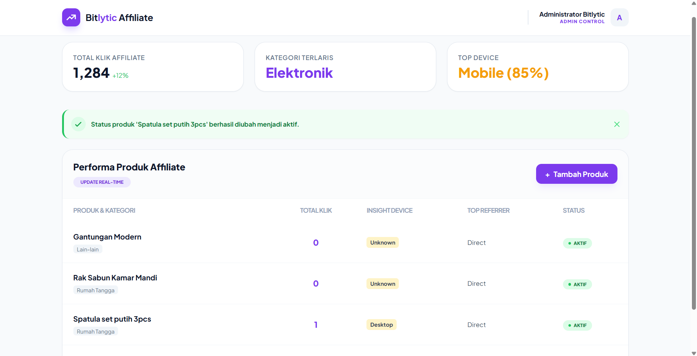

# 🔗 Short-Link Affiliate Management System

Aplikasi manajemen **short-link affiliate** berbasis CodeIgniter 3 — dibungkus dalam Docker untuk deployment yang konsisten dan portabel.



---

## 📖 Tentang Project

**Short-Link Affiliate** adalah aplikasi web untuk mengelola link affiliate, tracking klik, dan analisis performa produk. Dibangun dengan CodeIgniter 3 (PHP 7.4) dan MySQL.

Project ini awalnya berjalan di environment lokal biasa (Laragon), kemudian **di-containerize dengan Docker** agar:
- ✅ Portabel — bisa dijalankan di OS manapun
- ✅ Konsisten — environment dev = production
- ✅ Zero setup — tidak perlu install PHP/MySQL manual
- ✅ Mudah onboarding — 1 perintah untuk semua developer

---

## 🛠️ Tech Stack

| Layer | Teknologi |
|---|---|
| **Framework** | CodeIgniter 3.1.x |
| **Bahasa** | PHP 7.4 |
| **Web Server** | Apache 2.4 (dengan mod_rewrite) |
| **Database** | MySQL 5.7 |
| **Web UI DB** | phpMyAdmin 5.x |
| **Orkestrasi** | Docker Compose 3.8 |

---

## 🚀 Cara Menjalankan

### Prasyarat

- **Docker Desktop** sudah terinstall dan berjalan
- **Git** (untuk clone repo)

### Langkah-langkah

**1. Clone repository:**
```bash
git clone https://github.com/username/short-link.git
cd short-link

**2. Jalankan Docker Compose:**
```bash
docker compose up -d --build
```

Tunggu 2–5 menit untuk build pertama kali. Setelah selesai, 3 container akan berjalan:

```
✔ Container shortlink-db       Started
✔ Container shortlink-pma      Started
✔ Container shortlink-app      Started
```

**3. Import database:**
- Buka phpMyAdmin: http://localhost:8081
- Login: Server `db`, User `root`, Password `root`
- Klik database `shortlink_db` → tab **Import** → pilih file `database/shortlink.sql` → klik **Go**

**4. Buat tabel session:**
Buka tab **SQL** di phpMyAdmin, jalankan:

```sql
CREATE TABLE IF NOT EXISTS `ci_sessions` (
    `id` varchar(128) NOT NULL,
    `ip_address` varchar(45) NOT NULL,
    `timestamp` int(10) unsigned DEFAULT 0 NOT NULL,
    `data` blob NOT NULL,
    PRIMARY KEY (`id`),
    KEY `ci_sessions_timestamp` (`timestamp`)
) ENGINE=InnoDB DEFAULT CHARSET=utf8mb4;
```

**5. Akses aplikasi:**
- 🌐 **Web App:** http://localhost:8082
- 🗄️ **phpMyAdmin:** http://localhost:8081
- 🔐 **Login admin:** lihat tabel `admins` di database

### Menghentikan Aplikasi

```bash
docker compose down          # Stop container (data tetap tersimpan)
docker compose down -v       # Stop + hapus semua data (fresh start)
```

---

## 📁 Struktur Project

```
short-link/
├── application/               # Kode utama CodeIgniter 3
│   ├── config/               # Konfigurasi (database, session, dll)
│   ├── controllers/          # Controller
│   ├── models/               # Model
│   └── views/                # View
├── system/                    # Core framework CodeIgniter
├── database/
│   └── shortlink.sql         # Dump database untuk import
├── docs/                      # Screenshot & dokumentasi
│   └── screenshot-dashboard.png
├── Dockerfile                 # Image untuk PHP + Apache
├── docker-compose.yml         # Orkestrasi 3 service
├── .dockerignore              # File yang di-exclude dari image
├── .htaccess                  # Rewrite rules CodeIgniter
├── index.php                  # Front controller
└── README.md
```

---

## 🐳 Detail Arsitektur Docker

### Service 1: `app` (Aplikasi Web)

- **Image:** `php:7.4-apache` (custom build)
- **Port:** `8082 → 80`
- **Ekstensi PHP:** `mysqli`, `pdo`, `pdo_mysql`
- **Modul Apache:** `mod_rewrite` (aktif)
- **Volume:** `.` di-mount ke `/var/www/html` (live edit)

### Service 2: `db` (Database)

- **Image:** `mysql:5.7`
- **Port:** `3307 → 3306`
- **Volume:** `db_data` (persisten di `/var/lib/mysql`)
- **Env:** `MYSQL_ROOT_PASSWORD`, `MYSQL_DATABASE`

### Service 3: `phpmyadmin` (Web UI DB)

- **Image:** `phpmyadmin/phpmyadmin`
- **Port:** `8081 → 80`
- **Koneksi ke `db`** otomatis

### Diagram

```
                    ┌──────────────────────┐
    Browser ──────► │  localhost:8082      │
                    │  shortlink-app       │
                    │  (PHP 7.4 + Apache)  │
                    └──────────┬───────────┘
                               │
                               ▼
                    ┌──────────────────────┐
                    │  shortlink-db        │
                    │  (MySQL 5.7)         │
                    │  Volume: db_data     │
                    └──────────┬───────────┘
                               ▲
                               │
                    ┌──────────┴───────────┐
                    │  localhost:8081      │
                    │  shortlink-pma       │
                    │  (phpMyAdmin)        │
                    └──────────────────────┘
```

---

## 🔧 Konfigurasi Penting

### `application/config/database.php`

```php
'hostname' => 'db',              // nama service di docker-compose
'username' => 'root',
'password' => 'root',
'database' => 'shortlink_db',
```

### `application/config/config.php`

```php
$config['base_url'] = 'http://localhost:8082/';
$config['index_page'] = '';
$config['sess_driver'] = 'database';        // session di DB, bukan file
$config['sess_save_path'] = 'ci_sessions';
```

---

## 🐛 Troubleshooting

### Port 8082 sudah dipakai?

Ganti port di `docker-compose.yml`:
```yaml
ports:
  - "8090:80"    # ganti ke port lain
```

### Error `mkdir(): Invalid path`

Session driver perlu diganti ke `database` (lihat `config.php` di atas).

### Error `Unknown collation: 'utf8mb4_0900_ai_ci'`

Ini karena MySQL 8 vs 5.7. Edit file `.sql` kamu, ganti semua:
- `utf8mb4_0900_ai_ci` → `utf8mb4_general_ci`

### Database kosong padahal sudah `docker compose up`

Import ulang `shortlink.sql` via phpMyAdmin (lihat langkah 3 di atas).

---

## 📸 Screenshot

### Dashboard Admin


---

## 🎯 Fitur Utama

- 🔗 **Manajemen Link Affiliate** — buat, edit, hapus link
- 📊 **Tracking Klik** — statistik klik per link
- 🏆 **Analitik Produk** — kategori terlaris, top device, top referrer
- 👤 **Multi-user** — admin & affiliate
- 📱 **Tracking Device** — desktop vs mobile

---

## 📌 Changelog

### v1.0.0 — Dockerized
- Containerize aplikasi ke Docker Compose
- Migrasi session dari file ke database
- Setup phpMyAdmin sebagai service terpisah

---

## 📄 Lisensi

MIT License — silakan dipakai dan dimodifikasi.

---

## 👨‍💻 Author

**Ahmad Widodo**
- GitHub: [@ahmadwidodo](https://github.com/Rangers69)